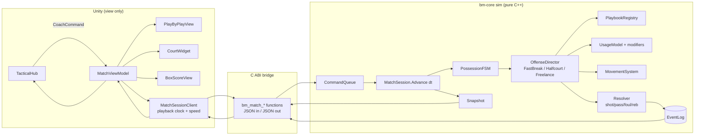
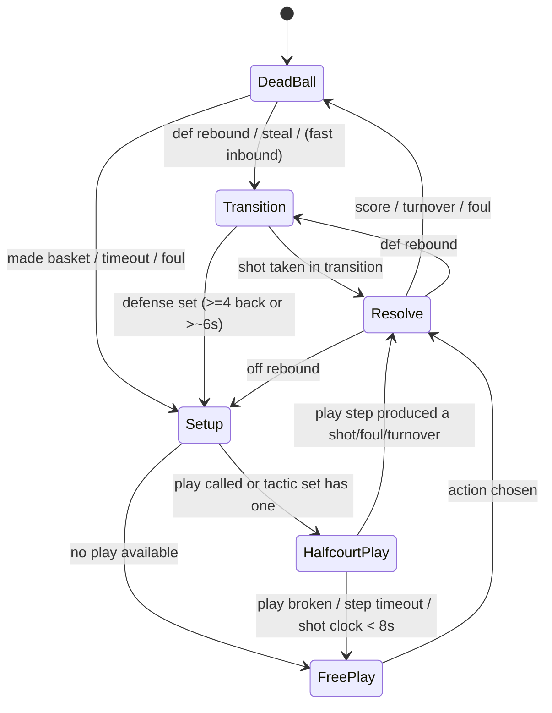
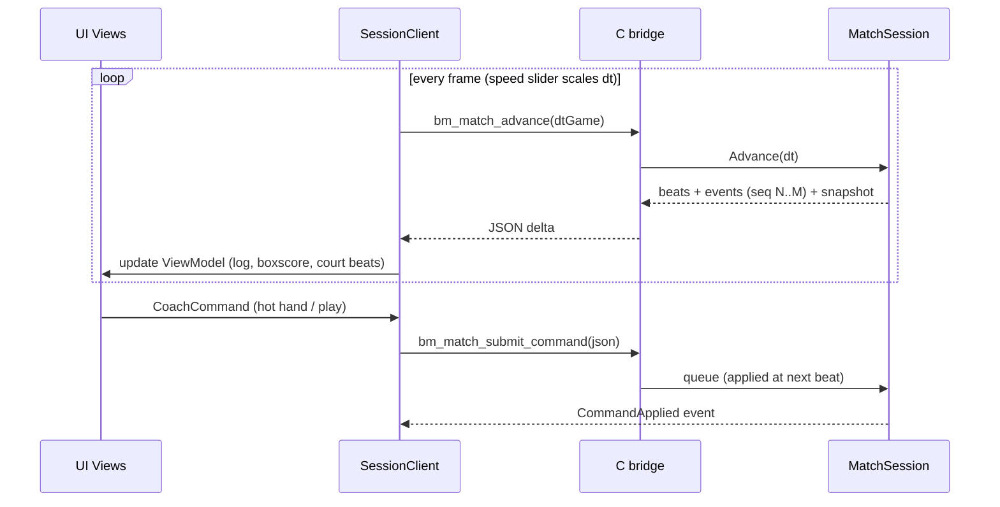
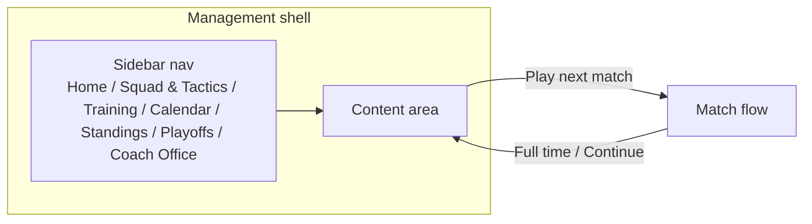
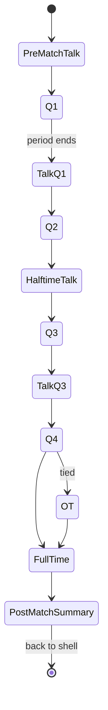

git # Basketball Manager - UI Implementation Roadmap

## Current State
✅ **Console Game Complete**: Fully functional text-based basketball simulator with:
- Real-time play-by-play
- Interactive controls (pause, timeout, subs)
- Live stats display
- Variable speed (1x-6x)

✅ **Native match bridge MVP**: `BMUnityBridge` can now open a database, load teams
by ID, start a match, advance one possession at a time, read live JSON state, and
send speed, timeout, and coaching commands. The native contract is exercised by the
`bridge-smoke` target.

⏳ **Still missing**: season bridge calls, substitutions through the C API, JSON
escaping/schema versioning, and a Unity scene/project. The current Unity C# file is
an interop wrapper, not a complete UI.

## UI Implementation Options

### Option 1: Web-Based UI (Recommended - Fastest to Market) 🌐

**Stack**: React + TypeScript + WebSocket
**Timeline**: 2-3 weeks

#### Architecture:
```
C++ Backend (MatchEngine)
    ↓ (WebSocket/REST API)
React Frontend
    - Live game display
    - Control panel
    - Stats dashboard
    - Court visualization
```

#### Advantages:
✅ Cross-platform (works on any browser)
✅ Fast development with modern web tools
✅ Easy deployment and updates
✅ Rich component libraries available
✅ Can use Canvas/Three.js for 2D/3D court

#### Implementation Steps:
1. **Create REST API wrapper around C++ engine**
   - `/api/match/start` - Initialize game
   - `/api/match/simulate` - Run N possessions
   - `/api/match/state` - Get current state
   - `/api/match/control` - Pause/timeout/sub

2. **WebSocket for real-time updates**
   - Stream play-by-play events
   - Live score updates
   - Player stat changes

3. **React Components**
   - GameBoard (court visualization)
   - ScoreBoard (score, time, quarter)
   - PlayByPlay (scrolling event feed)
   - PlayerCards (stats, fatigue)
   - ControlPanel (pause, speed, subs)

4. **Backend Bridge** (C++ → HTTP server)
   - Use cpp-httplib or Crow framework
   - Expose MatchEngine methods as API endpoints

#### Cost: FREE (all open-source tools)

---

### Option 2: Unity UI (Your Original Plan) 🎮

**Stack**: Unity + C# + C++ Bridge
**Timeline**: 4-6 weeks

#### Architecture:
```
C++ Core (libBMCore.dylib)
    ↓ (P/Invoke C# bindings)
Unity UI
    - 3D court with player models
    - Animated gameplay
    - Advanced graphics
```

#### Advantages:
✅ Professional game-quality graphics
✅ 3D player animations
✅ Rich visual effects
✅ Can port to mobile later
✅ You already have bm-ui/BMUnityBridge.cs started

#### Implementation Steps:
1. **Complete C# Bridge** (bm-ui/BMUnityBridge.cs)
   - Import libBMCore.dylib functions
   - Create C# wrappers for MatchEngine
   - Handle memory management (IntPtr, Marshal)

2. **Unity Scene Setup**
   - Basketball court model
   - Player GameObjects (5v5)
   - Camera system (multiple angles)
   - UI Canvas overlay

3. **Game Controller Script**
   ```csharp
   public class GameController : MonoBehaviour {
       void Update() {
           // Call C++ SimulatePossession()
           // Get MatchState
           // Update player positions
           // Display score/time
       }
   }
   ```

4. **Animation System**
   - Player movement between positions
   - Shooting animations
   - Dribbling, passing
   - Celebration animations

#### Cost: FREE (Unity Personal license)

---

### Option 3: Simple Desktop UI (Quickest Prototype) 🖥️

**Stack**: Dear ImGui (C++)
**Timeline**: 3-5 days

#### Architecture:
```
C++ MatchEngine + ImGui
    - Same process, direct calls
    - No web/Unity overhead
    - Simple but functional
```

#### Advantages:
✅ Fastest to implement (pure C++)
✅ No language barriers
✅ Lightweight and fast
✅ Built-in widgets for controls
✅ Good for debugging and testing

#### Implementation:
1. **Add ImGui to CMake**
   ```cmake
   find_package(imgui REQUIRED)
   target_link_libraries(MatchSimulator imgui)
   ```

2. **Create UI Window**
   ```cpp
   while (!quit) {
       ImGui::Begin("Basketball Manager");
       
       // Score display
       ImGui::Text("Q%d %s | %d - %d", 
           state->quarterNumber, clock.c_str(),
           state->homeScore, state->awayScore);
       
       // Control buttons
       if (ImGui::Button("Pause")) { /* ... */ }
       if (ImGui::Button("Timeout")) { /* ... */ }
       
       // Play-by-play scrolling text
       ImGui::BeginChild("PlayByPlay");
       for (auto& play : plays) {
           ImGui::Text("%s", play.c_str());
       }
       ImGui::EndChild();
       
       // Player stats table
       ImGui::BeginTable("Stats", 6);
       // ... render stats
       ImGui::EndTable();
       
       ImGui::End();
   }
   ```

#### Cost: FREE (ImGui is open-source)

---

### Option 4: Electron Desktop App 💻

**Stack**: Electron + React
**Timeline**: 2-3 weeks

#### Architecture:
```
Electron Main Process
    ↓ (Child Process / FFI)
C++ MatchEngine
    ↓ (IPC)
Electron Renderer (React)
```

#### Advantages:
✅ Native desktop app feel
✅ Use web technologies (React, etc.)
✅ Auto-updates built-in
✅ Cross-platform (Mac, Windows, Linux)

#### Cost: FREE

---

## Recommended Path Forward

### **Phase 4A: Web UI MVP (2 weeks)**
Start with web-based UI for fastest time-to-playable:

**Week 1: Backend API**
- [ ] Create REST API server (cpp-httplib)
- [ ] Expose MatchEngine endpoints
- [ ] Test with curl/Postman

**Week 2: React Frontend**
- [ ] Create React app
- [ ] Build scoreboard component
- [ ] Add play-by-play feed
- [ ] Implement control panel
- [ ] Connect to API

**Result**: Fully playable web-based basketball game

---

### **Phase 4B: Unity Full Game (Parallel work or after web MVP)**
Once web version proves the concept, build Unity version for:
- Better graphics
- 3D animations
- Professional polish
- Mobile potential

---

## Quick Win: Add ImGui to Console Simulator (3 days)

Want to see something visual **immediately**? Add ImGui to your existing console simulator:

```cpp
// In simulate_match.cpp
#include <imgui.h>
#include <imgui_impl_glfw.h>
#include <imgui_impl_opengl3.h>

int main() {
    // ... existing code ...
    
    // Create window
    GLFWwindow* window = glfwCreateWindow(1280, 720, "Basketball Manager", NULL, NULL);
    
    // ImGui setup
    ImGui::CreateContext();
    ImGui_ImplGlfw_InitForOpenGL(window, true);
    
    // Game loop
    while (!glfwWindowShouldClose(window)) {
        // Simulate possessions
        engine.SimulatePossession();
        
        // Render UI
        ImGui::NewFrame();
        RenderGameUI(engine.GetMatchState());
        ImGui::Render();
        ImGui_ImplOpenGL3_RenderDrawData(ImGui::GetDrawData());
        
        glfwSwapBuffers(window);
    }
}
```

This gives you:
- ✅ Visual scoreboard
- ✅ Live stats display
- ✅ Clickable buttons (no more typing 'p')
- ✅ Modern UI with minimal code

---

## My Recommendation

**Start with Option 3 (ImGui) for immediate visual feedback**, then build Option 1 (Web UI) for a polished product. Here's why:

1. **ImGui (3 days)**: Get visual confirmation your engine works with a UI
2. **Web UI (2 weeks)**: Build a shareable, cross-platform product
3. **Unity (later)**: Add once you have users and want premium graphics

**You'll have something visual by the end of this week!**

---

## Next Steps

Want me to:
1. ✅ **Implement ImGui wrapper** (3 days - visual game immediately)
2. 🌐 **Build REST API + React web UI** (2 weeks - shareable web game)
3. 🎮 **Complete Unity integration** (4-6 weeks - professional game)

Which would you like to start with? I recommend #1 (ImGui) for the quickest visual result!

---

# Unity Match UI and Simulation Design (2026-11)

Supersedes the options above: the chosen path is Unity + C++ core. Design only, not yet implemented.
Baseline = possession-level engine and the `OnGUI` HUD in `UI-unity-bm26/Assets/Scripts/MatchHUDController.cs`.

## A. Baseline gap

| Today | Needed |
|---|---|
| One engine call = one whole possession (12-20 s); ball handler and passer are random | Sub-possession actions: dribble, pass, cut, screen, shot |
| `UpdateSpatialState` snaps players to fixed slots with random jitter | Movement driven by offensive state and play |
| Coaching callouts = 8-possession momentum counter | Playbook + hot-hand usage weight |
| UI polls one JSON per possession and lerps | Event stream + snapshots, UI is a pure view |
| 3D Iso, Split view, shot arc, ball-holder halo, `[BALL]` tag, overlapping labels | None of these |
| Top tab bar, all screens in one `OnGUI` class | FM-style shell with side navigation (section G) |

## B. Layered architecture



Rules:
- The sim never knows about the UI. It exposes `Advance(gameSeconds)`, `Submit(CoachCommand)`, `EventsSince(seq)`, `Snapshot()`. Pause and speed live only in the UI playback clock.
- The UI never computes basketball. Score, box score, stamina and ball holder come from the snapshot.
- Commentary is a separate service mapping events to templates (Lua-moddable).
- Deterministic given a seed, so it is testable.

## C. Match screen layout (data-driven 2D dashboard)

```
+---------------------------------------------------------------+
| Scoreboard  BOS 15 - 18 NYK   Q1 04:09   timeouts / fouls     |
+----------------------+-----------------------+----------------+
| 2D COURT WIDGET      | LIVE PLAY-BY-PLAY     | LIVE BOX SCORE |
| top-down 94x50,      | scrolling, newest top | PTS REB AST    |
| dots + jersey no.,   | "Smith drives left,   | PF STAM        |
| ball icon only       |  kicks to Johnson"    | per player,    |
|                      |                       | both teams     |
+----------------------+-----------------------+----------------+
| TACTICAL HUB (always visible, never pauses the match)         |
| [Playbook: Horns | Pick&Roll | Motion | Iso ...]              |
| [Feed the hot hand: click a player]  [Tempo] [Defense] [Subs] |
| Active: "Horns (queued)"  "Feeding J. Tatum x1.6 (4 poss.)"   |
+---------------------------------------------------------------+
```

Court widget rules:
- Players are plain team-colored dots with jersey number only (names live in the box score).
- No halo on the holder, no `[BALL]` tag, no trail, no shot arc.
- The ball is one small icon: follows the holder's dot while dribbling; on `Pass`/`Shot` events it tweens between positions over the event `duration`.
- Delete 3D Iso and Split modes.
- Replace the single `OnGUI` class with separate views (UI Toolkit or uGUI).

## D. Simulation model: beats, not physics ticks

A beat is one action lasting 0.5-4 game-seconds (dribble move, pass, cut, screen, shot). Each beat carries from/to coordinates and a duration; the UI plays beats back on its own timeline, so frame rate never affects the sim.

```cpp
struct Beat { float t0, duration; ActionType type;
              PlayerId actor, target; Vec2 from, to;
              std::vector<PlayerMove> moves; };
struct MatchEvent { uint64_t seq; EventType type; float gameClock;
                    PlayerId a, b; int points; std::string meta; };
```

### Possession state machine



Mode priority each beat (highest first): forced states (dead ball, free throws) > Fast Break if trigger holds > coach-called play > tactic's default set > Freelance.

### Fast break
- Trigger: defensive rebound or steal; chance $p = f(\text{pace tactic}, \text{outlet passer ballControl+technical}, \text{numbers advantage})$.
- Behaviour: lane running (handler, two wings, trailer); shot weight boosted and defense penalised by missing defenders.
- Exit: first shot, turnover, or defense set.

### Halfcourt plays (data-driven)

```json
{ "id": "horns", "roles": ["handler","big1","big2","wing1","wing2"],
  "steps": [
   {"slots": {"handler":"top","big1":"elbow_L","big2":"elbow_R","wing1":"corner_L","wing2":"corner_R"},
    "advanceWhen": "arrived|timeout:3s"},
   {"action":"screen","by":"big1","for":"handler","then":"read"},
   {"read": [{"if":"handler.open>0.6","do":"shoot"},
             {"if":"roller.open>0.5","do":"pass:big1"},
             {"else":"pass:wing_weak"}]}
  ],
  "fallbackTo": "freelance" }
```

- Role assignment by score (handler by `ballControl`, spacer by `shooting`, screener by `physical`), not by listed position.
- Zones are points/polygons on the 94x50 grid, mirrored for attacking direction.
- Stored as JSON/Lua under `bm-data/playbooks/`.

### Free play (freelance)

$$U(a) = w_{attr}(a)\cdot \text{openness}(a)\cdot \text{spacing}(a)\cdot \text{usage}_i \cdot m_{coach}$$

| Option | Main weights |
|---|---|
| drive | `ballControl`, `pace` |
| spot-up shot | `shooting` |
| post-up | `physical` |
| pass | `technical`, teammate openness |
| cut, screen | `technical`, `physical` |

## E. Coaching commands

Command pattern: `CoachCommand { type, team, payload }` with types `CallPlay`, `FeedPlayer`, `ClearOverrides`, `SetTactics`, `Substitute`, `Timeout`, `TeamTalk`. Applied only at beat boundaries; the sim emits `CommandAccepted/Queued/Rejected`.

Playbook override: `CallPlay(id)` sets `team.calledPlay`; next Setup/HalfcourtPlay uses it instead of Freelance. Fast Break still wins on transition possessions.

Feed the Hot Hand: `FeedPlayer(id, strength, durationPossessions)` adds

```cpp
struct UsageModifier { PlayerId id; float mult; int possessionsLeft; };
w_i = clamp(baseUsage_i * fatigueMod * situationMod * Π mult, 0, cap)
```

- Pass target weight `passWeight_j = w_j * openness_j * passQuality`.
- Shooter's own shot threshold drops.
- Cost: shot quality drops by $k\cdot(m-1)$ (defense keys on him).
- Expires by possessions or substitution; decays linearly.

## F. UI to sim data flow



Proposed C ABI: `bm_match_advance(float dt)`, `bm_match_submit_command(const char* json)`, `bm_match_poll(uint64_t sinceSeq)`.

## G. FM-style app shell and match flow (playtest feedback, 2026-11-05)

Playtest of the current build: a full game runs to FINAL (Q4 00:00, 82-96); speed slider, box score and coach buttons work. Problems: UI is hard to read and not clean; buttons and tabs need a consistent style; `Resume` still shows and `[BALL]` still shows after FINAL; player tokens and labels overlap and cluster on one half.

### App shell
Football Manager style: a persistent left sidebar for navigation (Home, Squad & Tactics, Training & Staff, Calendar, Standings, Playoffs, Coach Office) with the content area to the right. Not a bottom sheet or a top tab bar. One shared theme for buttons, panels and tables.



### Match flow
Starting a match leaves the shell and enters a dedicated match mode with talks at fixed points.



Team talk:
- Shown before the match and after every period (Q1, halftime, Q3), skippable.
- Options such as Praise, Encourage, Demand more, Calm down, Criticize; chosen at team level, optionally for a single player.
- Sent as a `TeamTalk` command; the sim applies a short-lived morale/composure modifier that depends on game situation and carries a risk (a wrong tone can backfire).
- Post-match summary: result, player ratings, box score, then Continue to the shell.

## H. Module layout

```
bm-core/include/sim/   MatchSession.h  PossessionFSM.h  OffenseDirector.h
                       Playbook.h  UsageModel.h  Movement.h  Resolver.h
                       Commands.h  Events.h  Snapshot.h
bm-data/playbooks/     horns.json  pick_and_roll.json  motion.json  iso.json
UI-unity-bm26/Assets/Scripts/Match/  SessionClient  ViewModel  Views/*
UI-unity-bm26/Assets/Scripts/Shell/  Sidebar  Theme  Screens/*
```

The existing `MatchEngine` outcome maths (fouls, blocks, rebounds, fatigue) moves into `Resolver` and is reused.

## I. Phases

1. UI shell and match-view cleanup: sidebar navigation, shared theme, remove 3D/Split/arc/halo/`[BALL]`, ball as lone icon, number-only dots, hide Resume after FINAL.
2. Match flow: dedicated match mode, pre-match talk, period talks, post-match summary.
3. Sim skeleton: beat tick, `EventLog`, snapshot, `CommandQueue`, new bridge API (behaviour unchanged).
4. Offense director: FSM, fast break, freelance.
5. Playbook: JSON loader, role assignment, halfcourt steps, starter plays.
6. Coach layer: `CallPlay`, hot hand, tactical hub, `TeamTalk` effects.
7. Live box score, commentary templates, tests (seeded determinism, FSM transitions, bounds/5v5/clock invariants, extended `bridge-smoke`).

### Status (2026-11-05)

- Done: phase 1 (UI shell and match-view cleanup).
- Done, ahead of phase 2: the live flow. `MatchEngine::StepSecond()` plays one game second at a time (`StepMatchSeconds` in the bridge). A possession is planned first (`PlanPossession`), then choreographed into beats (inbound, advance or fast break, passes, drive, shot, rebound, free throws) by `BuildScript`; score and stats change when the deciding beat completes. Fast break and half-court motion exist; freelance play is the dribble/cut/spacing movement between passes. Playbook calls, the usage multiplier and the beat/event API from sections D to F are still open (phases 5 and 6).
- Done, phase 2 (match flow): match mode with the sidebar hidden, NBA timeout rules (full 75 s / short 20 s, queued for the next dead ball), pre-match, quarter, half-time and overtime team talks with per-player reactions and morale, quarter breaks.
- Done, module 1 (coach layer, partly phase 6): a dedicated Substitution panel with queued changes; offense choices (shoot more 3s, play more inside, pick and roll, move the ball, play through a chosen player) with a playbook of ten plays (`GetPlaybookJson`); six defense schemes; individual player feedback (settle down, focus on defense, look for your shot) with a reaction from the player (`GiveFeedback`). The match clock waits while a coach panel is open. Engine tests (8) cover the scheme and feedback effects over 40-game samples.
- Done, module 2 (accounts and career): local accounts (unique username, password rules, salted PBKDF2-SHA256, constant-time compare, a 30 s lock after five failures), career saves per account under `Application.persistentDataPath/saves`, a new-career wizard (coach with a 60-point attribute pool, then team, then start) and the Coach Office as the editor for the existing coach. The coach style sets the starting offense and defense in matches the coach plays; wins and losses are added to the career record.
- Known limits: accounts are local only (no cloud sync, no password recovery). A save stores the account, coach, team and career record, not the season progress: loading a career starts a fresh 2026/27 season, because the native `SeasonManager` has no serialization yet. The coach panels always control the home side of a match. Playbook roles per position and the `Resolver` split (sections D and F) are still open.
- Next: serialize the season (calendar, results, standings) into the career save; phase 3 and 4 refactor of the sim skeleton.
